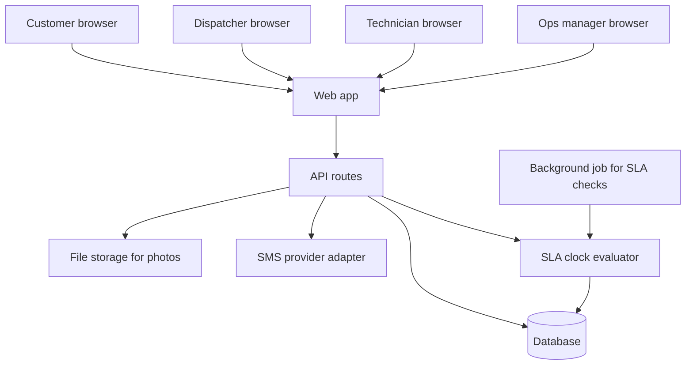
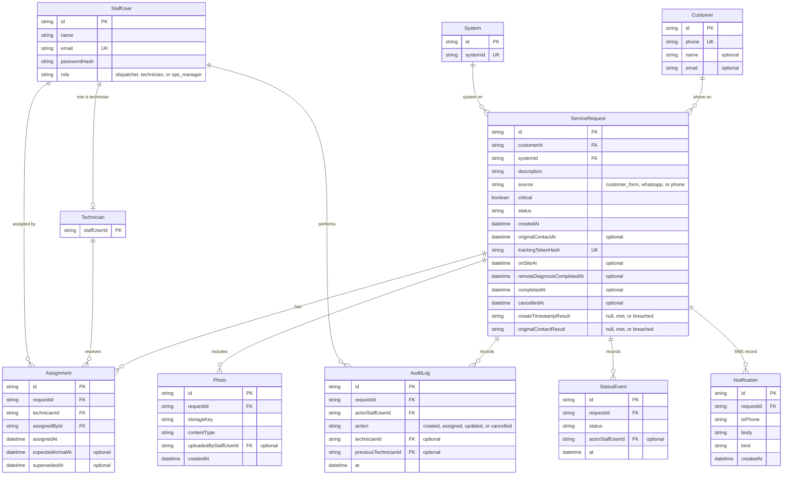
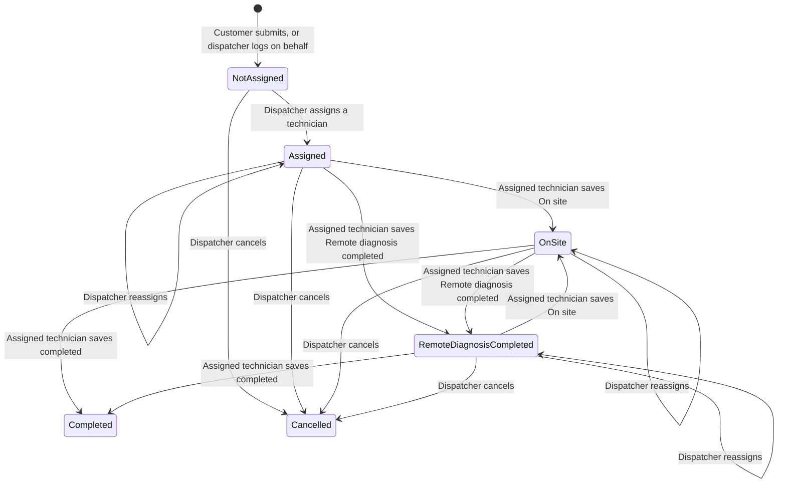

# FixFlow architecture

Design for the BrightRoof MVP. Sources: [AGENTS.md](../../AGENTS.md), [PRD](../requirements/PRD.md), [epics](../requirements/epics.md), and the stories under [docs/requirements/stories/](../requirements/stories/).

Workshop answers override suggested defaults. Where a story still has an open question, this document leaves the behavior unset rather than filling it in. Suggested defaults in [questions.md](../requirements/questions.md) and the assumptions in the PRD are labeled when this design uses one.

Stack, already chosen for this repo: Next.js and TypeScript web app, Prisma 7, SQLite in development, Postgres in production. English UI. Customers have no accounts. Intake is the public form plus a dispatcher typing WhatsApp and phone requests. There is no WhatsApp API, hotline API, email channel, or Google Sheet sync in this design.

No paid third-party service is selected. SMS, durable photo storage, the Postgres host, a hosted job runner, and any identity provider stay unset until BrightRoof chooses them. See [Third-party services](#third-party-services).

---

## 1. Components



| Piece | Responsibility |
| --- | --- |
| Web app | Next.js UI in `src/app`. Customer pages need no session. Staff pages require a signed-in session and render only what that role may see. Technician pages are usable at 390 CSS pixels wide. |
| API routes | Route handlers under `src/app/api`. They enforce the permission rules, write the database, store photo bytes, record SMS, and run the SLA evaluator in the same save as a status change. |
| Database | Prisma 7. SQLite for local development. Postgres for production. The production host is not selected. |
| File storage for photos | Bytes for a `Photo` row. The API reads them back after an authorization check. Development uses a directory on the app server. A hosted object store is not selected. |
| SMS provider adapter | Sends one message to a phone number. The stories require a recorded outbound SMS. The live provider is not selected. Tests use an adapter that records the destination and body. |
| Background job for SLA checks | Calls the SLA clock evaluator on a timer so a critical request can become breached after 24 hours with no staff action. |
| SLA clock evaluator | Pure rules in section 6. The API calls it when a relevant field is saved. The job calls it for requests whose window can expire with no further save. |

Staff sign-in creates a server session. The session id is an unguessable random value in an httpOnly cookie. The database stores only a hash of that id, the staff user, and an expiry. Sign-out deletes the session. The sign-in check is the staff user's email and password against the staff row, with no identity provider ([staff-sign-in](../requirements/stories/staff-sign-in.md)). Single sign-on is not selected. Password length, lockout, and creating the first ops manager account are out of scope for MVP.

The web app and the API share one injectable clock. Tests set it to a Saturday, a weekday, 30 November 2026, 1 December 2026, or a moment past 86400 seconds. Saved timestamps use that clock at the successful save.

---

## 2. Data model

`Technician` is a staff user whose role is technician. Dispatcher and ops manager are staff users with the other roles. One `StaffUser` table holds all three so audit and sign-in share one identity. The diagram still shows `Technician` because an assignment names a technician.

Customers and systems are rows created the first time that phone number or system id appears on a request. A new system id is accepted when it is not already stored. Nothing in the stories checks the id against a fixed registry of 2,000 systems.



### Request fields the stories require

A public create stores phone, system id, description, a new request id, and `createdAt`. Name, site address, email, and photo may be absent. Source for that create is `customer_form`.

An on-behalf create stores the same required fields plus source `whatsapp` or `phone`. `originalContactAt` is stored only when the dispatcher submits one. It is a different column from `createdAt`.

`critical` stays false until a dispatcher marks the request critical.

A second open request for the same phone and system id is a new row. The first row is left as it was.

### Assignment

Each save inserts an `Assignment`. The previous current row, if any, gets `supersededAt`. The current assignee is the row whose `supersededAt` is empty. That row’s `assignedAt` is the assignment timestamp the stories read.

`expectedArrivalAt` is set only when the dispatcher sends one. Reassignment stores the arrival time from that save, including clearing it when this save omits one.

The weekly workload count uses this current row only. A job counts for a technician in a Monday–Sunday week when that technician is the current assignee and `assignedAt` falls in the week in the report timezone. The previous assignee’s count does not include it. The report timezone is configuration. Naming the zone is out of scope.

### Status projection

`status` is derived, then stored, in this order:

1. `cancelled` when `cancelledAt` is set.
2. `completed` when `completedAt` is set.
3. `on_site` or `remote_diagnosis_completed`, whichever of those two timestamps is later.
4. `assigned` when a current assignment exists and neither response timestamp is set.
5. `not_assigned` otherwise.

A later On site save replaces `onSiteAt` with the server time of that save. A later remote-diagnosis save does the same for `remoteDiagnosisCompletedAt`. The other timestamp stays. The SLA response instant is the earlier of the two columns that are present. `StatusEvent` appends every change so the history remains after a column is replaced.

### Tracking secret

Creating a request generates a 256-bit random token. The database stores only its SHA-256 hash. The raw token is returned once in the create response and placed in the create SMS. The public path is `/track/{token}`. A URL that only changes the request id does not match a hash, so it returns none of the phone, system id, or status.

### Photos

The `Photo` row holds metadata. The bytes live under `storageKey` in file storage. The tracking response does not include photos. Whether the customer may see them is still open.

### Audit and SMS records

Staff creates, assignments, technician updates, and dispatcher cancellations append an `AuditLog` row in the same transaction as the change. A customer self-log has no audit actor in the stories, so this design writes no audit row for it until that question is answered.

Each required SMS inserts one `Notification` in the same transaction as the save. Kinds: `tracking_link`, `assigned`, `on_site`, `remote_diagnosis`. The adapter runs after the transaction commits. A provider rejection does not roll back the request. What the product does after that rejection is out of scope.

### Reports that read this model

Open jobs are requests whose status is neither `completed` nor `cancelled`. Each row shows request id, phone, system id, current assignee name when there is one, and `critical`.

SLA breach report lists critical requests whose `createTimestampResult` is `breached`.

Average time to resolve for a chosen start and end instant is the arithmetic mean of `completedAt - createdAt` for requests whose `completedAt` is inside the period. A period with no such completions shows 0 completed requests and no average. That duration is separate from the 24-hour response clock.

---

## 3. Request lifecycle



Reassignment changes the current assignee and `assignedAt`. It leaves status, `onSiteAt`, and `remoteDiagnosisCompletedAt` as they were. Both response statuses remain reachable from each other so the later save can become the status the tracking page shows, while the earlier timestamp still exists for the SLA rule.

`Cancelled` has no outgoing transition. Reopening is out of scope, so it is not allowed here.

`Completed` is a real status: open jobs exclude it, and average time to resolve reads `completedAt`. The assigned technician enters it from On site or Remote diagnosis completed ([technician-update-job](../requirements/stories/technician-update-job.md) AC11). No other role can.

### Allowed transitions

| From | To | Who | What is stored |
| --- | --- | --- | --- |
| — | Not assigned | Customer with phone, system id, and description; or a signed-in dispatcher with those fields and source WhatsApp or phone | New request, `createdAt`, tracking token. Dispatcher may also store `originalContactAt`. |
| Not assigned | Assigned | Signed-in dispatcher, and the chosen user has the technician role | Current assignment, `assignedAt`. Optional `expectedArrivalAt`. |
| Assigned, On site, or Remote diagnosis completed | Same status | Signed-in dispatcher, to a different technician | New current assignment. Previous assignee kept on the closed assignment row. |
| Assigned, On site, or Remote diagnosis completed | On site | Signed-in technician who is the current assignee, and the server received the save | `onSiteAt` = server time of this save. Status follows the projection above. |
| Assigned, On site, or Remote diagnosis completed | Remote diagnosis completed | Same assigned technician, server received the save | `remoteDiagnosisCompletedAt` = server time of this save. |
| On site or Remote diagnosis completed | Completed | Signed-in technician who is the current assignee, and the server received the save | `completedAt` = server time of this save. |
| Not assigned, Assigned, On site, or Remote diagnosis completed | Cancelled | Signed-in dispatcher, and the request is not already completed or cancelled | `cancelledAt` = server time of this save. |

A failed submit while the technician’s browser cannot reach the server writes no timestamp and no photo. The next successful submit uses the later server time.

### Refused attempts

The stored request stays as it was.

| Attempt | Outcome required by the stories |
| --- | --- |
| Signed-out user or a technician assigns | Assignee unchanged. |
| Technician, or a signed-out user, cancels | Status unchanged. |
| Assign a dispatcher or an ops manager | Assignee unchanged. |
| Assign or reassign while cancelled | Assignee unchanged, status stays cancelled. |
| Technician updates a job assigned to someone else, including after it was reassigned away from them | Update not saved, assignee unchanged. |
| Assigned technician updates a cancelled request | Update not saved, status stays cancelled ([cancel-request](../requirements/stories/cancel-request.md) AC2). |
| Anyone other than the assigned technician saves completed | Update not saved, status unchanged. |
| Signed-out user or a technician creates an on-behalf request | No request stored. |

Ops manager assign, on-behalf create, and cancel are out of MVP. The stories do not grant them, so they stay refused.

Marking `critical` is not a status transition. A signed-in dispatcher may set it on create or on a later edit.

---

## 4. API routes

Handlers live under `src/app/api`. A staff route with no session responds with the sign-in challenge and no request data. A refused role writes nothing and returns no data that the acceptance criterion withholds.

Pages that carry those actions: `/sign-in`, `/requests/new`, `/track/{token}`, `/dispatch/requests/new`, `/dispatch/requests/{id}`, `/technician/jobs`, `/technician/jobs/{id}`, `/ops/open-jobs`, `/ops/reports`, `/ops/requests/{id}`. Technician pages are built for a 390 CSS pixel viewport. Those pages are the screens the criteria name; the table is the API behind them.

| Method | Path | Role | Story / AC |
| --- | --- | --- | --- |
| POST | `/api/session` | Public. Matching staff email and password only. | [staff-sign-in](../requirements/stories/staff-sign-in.md) AC1, AC4 |
| DELETE | `/api/session` | Signed-in staff | [staff-sign-in](../requirements/stories/staff-sign-in.md) AC3. After this, staff screens show sign-in and no request data (AC2, AC3). |
| GET | `/api/staff/{staffId}` | Ops manager | [roles-and-permissions](../requirements/stories/roles-and-permissions.md) AC1 |
| POST | `/api/requests` | Customer, no account. Body: phone, system id, description. Optional one image. | [customer-log-request](../requirements/stories/customer-log-request.md) AC1–AC12. [attach-photos](../requirements/stories/attach-photos.md) AC1, AC3. [customer-tracking-link](../requirements/stories/customer-tracking-link.md) AC1. [sms-notify-customer](../requirements/stories/sms-notify-customer.md) AC1, AC4, AC6. |
| POST | `/api/requests/on-behalf` | Dispatcher. Body: phone, system id, description, source `whatsapp` or `phone`. Optional `originalContactAt`. | [dispatcher-log-on-behalf](../requirements/stories/dispatcher-log-on-behalf.md) AC1, AC3–AC10. AC2 is the assignment route, the status route, and the open-jobs route. [audit-log](../requirements/stories/audit-log.md) AC1. [classify-critical-fault](../requirements/stories/classify-critical-fault.md) AC1–AC3, AC5 when `critical` is sent. |
| GET | `/api/technicians` | Dispatcher | [dispatcher-assign-technician](../requirements/stories/dispatcher-assign-technician.md) AC4, AC9. Payload is technician-role users only. |
| GET | `/api/requests/{id}` | Dispatcher, ops manager, or the assigned technician | Backs assign, photos, SLA, and open-job detail. Other technicians receive no photo (attach-photos AC5). |
| PATCH | `/api/requests/{id}` | Dispatcher. Body may set `critical`. | [classify-critical-fault](../requirements/stories/classify-critical-fault.md) AC1–AC5. Saving `critical` re-runs the SLA evaluator ([sla-24h-response](../requirements/stories/sla-24h-response.md) AC4 when the request is not critical; AC2 and AC8 when this save is after the window and there is still no response). |
| POST | `/api/requests/{id}/assignments` | Dispatcher. Body: technician id. Optional `expectedArrivalAt`. | [dispatcher-assign-technician](../requirements/stories/dispatcher-assign-technician.md) AC1–AC3, AC5–AC8. [dispatcher-log-on-behalf](../requirements/stories/dispatcher-log-on-behalf.md) AC2 (assign succeeds). [roles-and-permissions](../requirements/stories/roles-and-permissions.md) AC2, AC4, AC5. [audit-log](../requirements/stories/audit-log.md) AC2, AC5. [sms-notify-customer](../requirements/stories/sms-notify-customer.md) AC2, AC5, AC7, AC8. [customer-tracking-link](../requirements/stories/customer-tracking-link.md) AC2, AC6, AC9, AC10. |
| POST | `/api/requests/{id}/cancellation` | Dispatcher, and status is neither completed nor cancelled | [cancel-request](../requirements/stories/cancel-request.md) AC1, AC4, AC5. [audit-log](../requirements/stories/audit-log.md) AC6. The same transaction runs the SLA evaluator ([sla-24h-response](../requirements/stories/sla-24h-response.md) AC6). |
| GET | `/api/technician/jobs` | Technician | [technician-update-job](../requirements/stories/technician-update-job.md) AC9, AC10. Only that technician’s current assignments. |
| POST | `/api/requests/{id}/status` | Current assignee. Body: `on_site`, `remote_diagnosis_completed`, or `completed`. Optional one image. | [technician-update-job](../requirements/stories/technician-update-job.md) AC1–AC8, AC11. [cancel-request](../requirements/stories/cancel-request.md) AC2. [dispatcher-log-on-behalf](../requirements/stories/dispatcher-log-on-behalf.md) AC2 (technician update succeeds). [attach-photos](../requirements/stories/attach-photos.md) AC2, AC3, AC6. [audit-log](../requirements/stories/audit-log.md) AC3. [sms-notify-customer](../requirements/stories/sms-notify-customer.md) AC3. [customer-tracking-link](../requirements/stories/customer-tracking-link.md) AC7. The same transaction runs the SLA evaluator ([sla-24h-response](../requirements/stories/sla-24h-response.md) AC1, AC5, AC7, AC11). |
| GET | `/api/requests/{id}/photos/{photoId}` | Dispatcher, ops manager, or the assigned technician | [attach-photos](../requirements/stories/attach-photos.md) AC1, AC2, AC4, AC5. |
| GET | `/api/track/{token}` | No session. Valid token only. | [customer-tracking-link](../requirements/stories/customer-tracking-link.md) AC1–AC10. [roles-and-permissions](../requirements/stories/roles-and-permissions.md) AC3. Response fields: request id, status, assignee name when assigned, expected arrival to the second or the text `no arrival time`. |
| GET | `/api/requests/{id}/audit` | Ops manager | [audit-log](../requirements/stories/audit-log.md) AC4, and the entries from AC1–AC3, AC5, AC6. |
| GET | `/api/requests/{id}/sla` | Ops manager | [sla-24h-response](../requirements/stories/sla-24h-response.md) AC3, AC9, AC10 on `/ops/requests/{id}`. The body includes the stored results for AC1, AC2, AC4, AC5, AC6, AC7, AC8, and AC11. |
| GET | `/api/reports/open-jobs` | Ops manager | [ops-open-jobs](../requirements/stories/ops-open-jobs.md) AC1–AC5. [cancel-request](../requirements/stories/cancel-request.md) AC3. [dispatcher-log-on-behalf](../requirements/stories/dispatcher-log-on-behalf.md) AC2 (listed while not completed and not cancelled). |
| GET | `/api/reports/sla-breaches` | Ops manager | [ops-sla-workload-reports](../requirements/stories/ops-sla-workload-reports.md) AC1. |
| GET | `/api/reports/time-to-resolve?from=&to=` | Ops manager | [ops-sla-workload-reports](../requirements/stories/ops-sla-workload-reports.md) AC2, AC6. `from` and `to` are instants. |
| GET | `/api/reports/jobs-per-technician?weekStart=` | Ops manager | [ops-sla-workload-reports](../requirements/stories/ops-sla-workload-reports.md) AC3, AC5. Week is Monday 00:00:00 through Sunday 23:59:59 in the report timezone. |
| timer | In-process SLA job | No HTTP caller. About once a minute in the Next.js server. | [sla-24h-response](../requirements/stories/sla-24h-response.md) AC2, AC4, AC6, AC8 when the window expires with no further save. Writes the stored result. The response timestamps stay unchanged. |

The timer row is the in-process SLA job. It has no path under `src/app/api`.

A technician or a tracking-link customer who calls the open-jobs or report routes receives none of those lists ([ops-open-jobs](../requirements/stories/ops-open-jobs.md) AC3, [ops-sla-workload-reports](../requirements/stories/ops-sla-workload-reports.md) AC4).

Create and assignment responses include the facts those screens and SMS bodies must show. The create SMS body contains the tracking link for that request id. The assignment SMS body contains `assigned`, plus the expected arrival timestamp to the second, or the text `no arrival time` when that timestamp was omitted. An On site SMS body contains `on site`. A remote-diagnosis SMS body contains `remote diagnosis`. Two creates to the same phone produce two SMS records with two links. Cancellation has no SMS in the current criteria.

The public create route stays available on Monday through Sunday and on 30 November 2026 and 1 December 2026. It does not call a sheet, a WhatsApp API, or email.

There is no public route that completes a request, and no customer cancel route.

---

## 5. Role-permission matrix

Yes means a story requires the action to succeed. No means a story requires it to leave stored data unchanged or to withhold the data. Unset means a story leaves that role open; the API refuses it until a story grants it.

| Action | Customer | Dispatcher | Technician | Ops manager |
| --- | --- | --- | --- | --- |
| Sign in to a staff session | No account | Yes | Yes | Yes |
| Submit the public request form | Yes | Unset | No | Unset |
| Create an on-behalf request | No | Yes | No | Unset |
| List technicians who can be assigned | No | Yes | No | Unset |
| Assign or reassign a technician | No | Yes | No | Unset |
| Cancel a request that is not completed | No | Yes | No | Unset |
| Save On site or Remote diagnosis completed | No | No | Yes, current assignee only | No |
| Save Completed | No | No | Yes, current assignee, from On site or Remote diagnosis completed | No |
| Mark critical | Unset | Yes | No | Unset |
| Attach a photo on public create | Yes, optional | Unset on on-behalf create | No | Unset |
| Attach a photo on a job update | No | Unset | Yes, current assignee, and the server is reachable | Unset |
| View a stored photo | Unset | Yes | Current assignee yes. Any other technician no | Yes |
| Open a tracking link | Yes, with that request’s token | Yes, with the token | Yes, with the token | Yes, with the token |
| List every open job | No | Unset | No | Yes |
| List own assigned jobs | No | No | Yes | No |
| SLA breach, time-to-resolve, and jobs-per-week reports | No | Unset | No | Yes |
| See SLA timestamps and both results | Unset | Unset | Unset | Yes |
| Read the audit history | Unset | Unset | Unset | Yes |
| View a staff user’s role | No | Unset | Unset | Yes |

A customer never gains a staff session by identifying with a phone number and a system id.

---

## 6. SLA clock

The warranty rule in the workshop is: a technician is on site, or remote diagnosis is completed, within 24 hours of the request. The working clock in [sla-24h-response](../requirements/stories/sla-24h-response.md) measures that from the FixFlow create timestamp. That matches the PRD assumption and is not a workshop answer. Warranty owners have not said whether the contract should use this clock or the original-contact clock. Both are stored. Writing one never changes the other.

The window is 86400 seconds. Comparison uses elapsed time between instants, so a display timezone cannot move a result across the boundary. Timestamps are stored as UTC instants. The zone used to display them is still open.

### Response instant

```
responseAt = earlier of onSiteAt and remoteDiagnosisCompletedAt
             among the columns that are set
```

If neither column is set, there is no response instant. The columns hold the server time of the latest successful save of that status. An offline attempt that never reached the server is not a response instant.

### Create-timestamp result

Stored on `ServiceRequest.createTimestampResult` as `met`, `breached`, or null.

```
if critical is false:
  result = null
else if cancelledAt is set and responseAt is null:
  result = null
else if cancelledAt is set and responseAt is set:
  leave the stored result unchanged
else if responseAt is null and now <= createdAt + 86400 seconds:
  result = null
else if responseAt is null and now > createdAt + 86400 seconds:
  result = breached
else if responseAt <= createdAt + 86400 seconds:
  result = met
else:
  result = breached
```

Null means the request is not recorded as met and not recorded as breached. That covers a non-critical request, a critical request still inside the window, and a cancelled critical request that never received a response. A cancelled request that already has a response timestamp is unspecified in the stories, so the evaluator does not relabel it.

`at most 86400 seconds` is met. `more than 86400 seconds` is breached.

### Original-contact result

Stored on `ServiceRequest.originalContactResult`.

```
if critical is false or originalContactAt is null:
  result = null
else:
  same comparisons as the create-timestamp result,
  using originalContactAt in place of createdAt
```

A request with no original contact timestamp never receives an original-contact result. When both results exist, the ops SLA view shows original contact timestamp, create timestamp, original-contact result, and create-timestamp result.

### When the result is written

The evaluator runs inside the transaction that saves a response timestamp (`POST /api/requests/{id}/status`: [sla-24h-response](../requirements/stories/sla-24h-response.md) AC1, AC5, AC7, AC11), a cancellation (`POST /api/requests/{id}/cancellation`: AC6), or a change to `critical` (`PATCH /api/requests/{id}`: AC4 when the request is not critical; AC2 and AC8 when that save is after the window and there is still no response).

The background job runs the same function for requests whose result can still change because time passed and nobody saved a response ([sla-24h-response](../requirements/stories/sla-24h-response.md) AC2, AC4, AC6, AC8). It uses the same injectable clock. It does not invent an on-site or remote-diagnosis timestamp. A breach caused only by the deadline is recorded when the job runs, so the report can lag until the next run. The pilot schedule is once a minute, in-process, in the Next.js server. Tests call the evaluator directly and do not wait for the timer. `GET /api/requests/{id}/sla` returns the stored results.

The job is not a second definition of the window. A request is breached because `now` is more than 86400 seconds after the start and no response instant exists, not because of the minute on which the job happened to wake.

### What this clock is not

Average time to resolve uses `completedAt - createdAt` for completed requests in a chosen period. It is not the 24-hour warranty result.

The jobs-per-technician week uses the report timezone and the current assignment timestamp. It does not start or stop the SLA clock.

---

## Third-party services

These are required by the product or by production hosting, and none is chosen:

| Need | What this design does now | What needs a decision |
| --- | --- | --- |
| SMS | Adapter plus a `Notification` row. Tests record the send. | Provider, sender id, and who pays. Delivery receipts are out of the acceptance criteria. |
| Photo bytes | Directory on the app server, keyed from the `Photo` row. | A durable store if the host disk does not survive redeploy. Object storage is a paid service and is not selected. |
| Production database | Postgres, as [AGENTS.md](../../AGENTS.md) requires. SQLite remains the development database. | The Postgres host. |
| SLA schedule | In-process timer calling the evaluator. | A hosted scheduler only if the app server does not stay running. That host may be a paid service. |
| Staff identity | Session cookie against a staff row. Sign-in checks that row's email and password. | None. SSO is not selected. Password length, lockout, and first-account provisioning are out of scope for MVP. |

---
